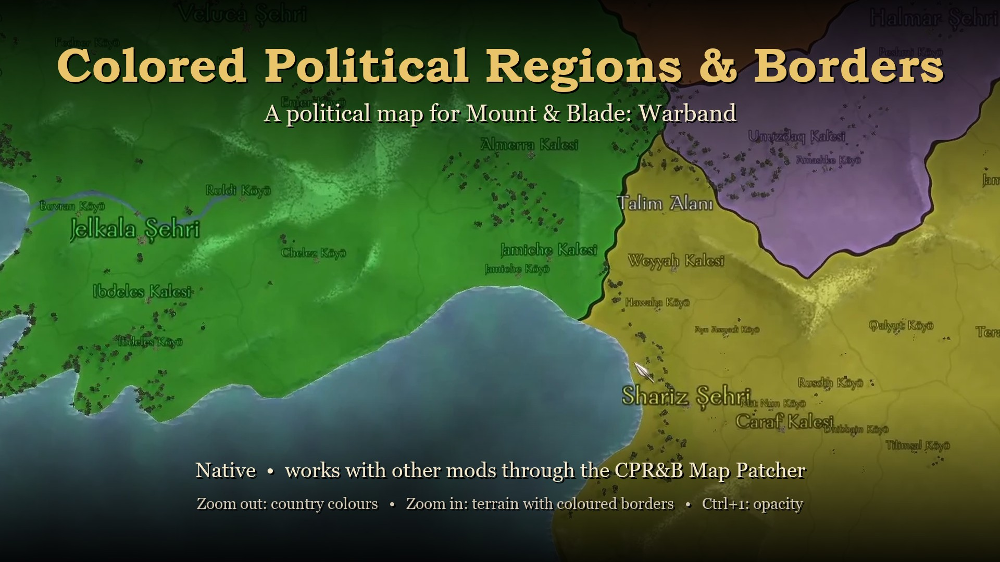
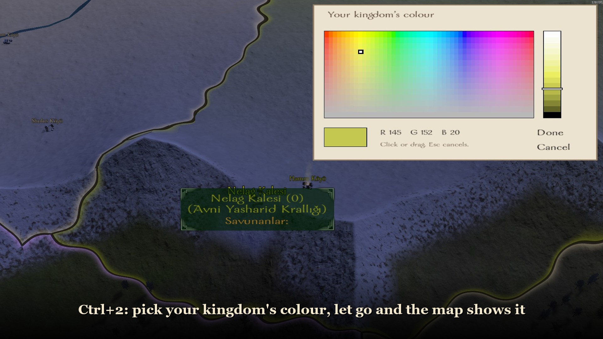
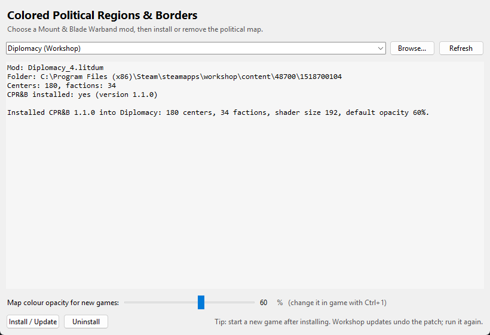
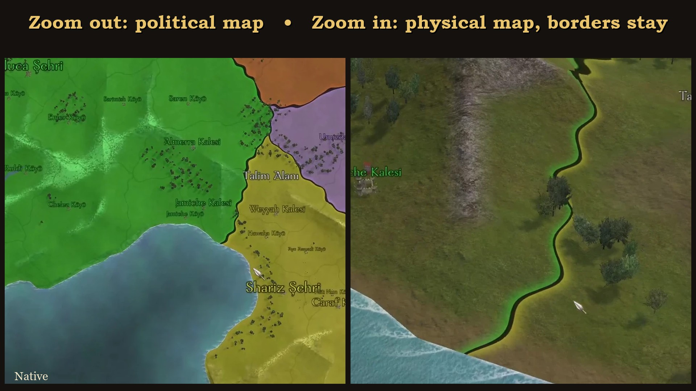
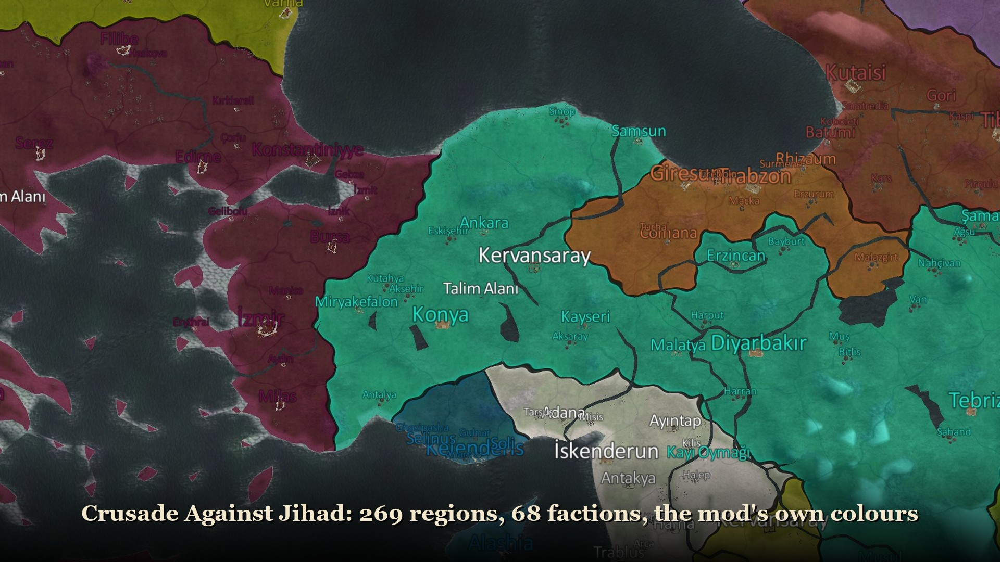
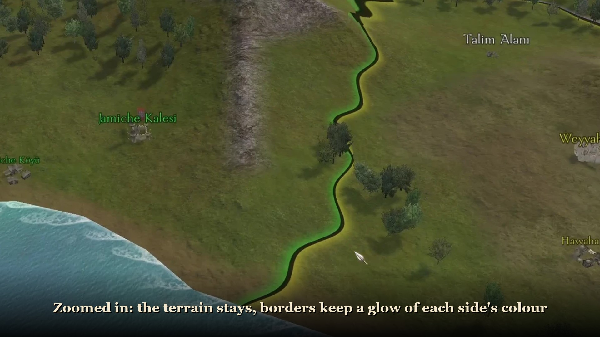
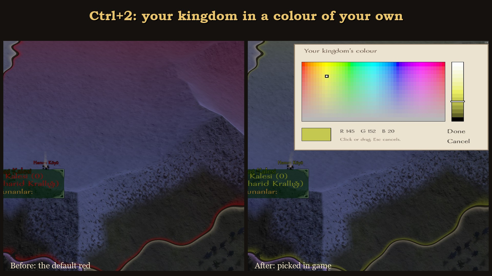
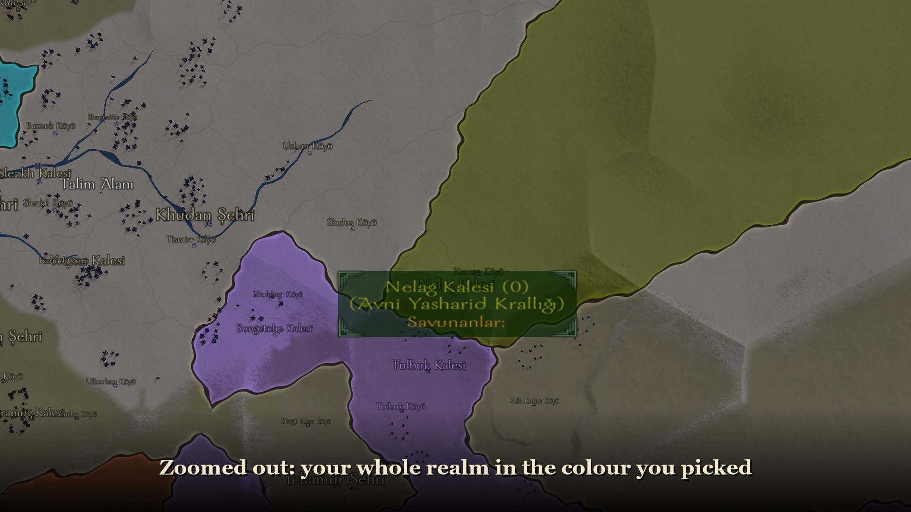
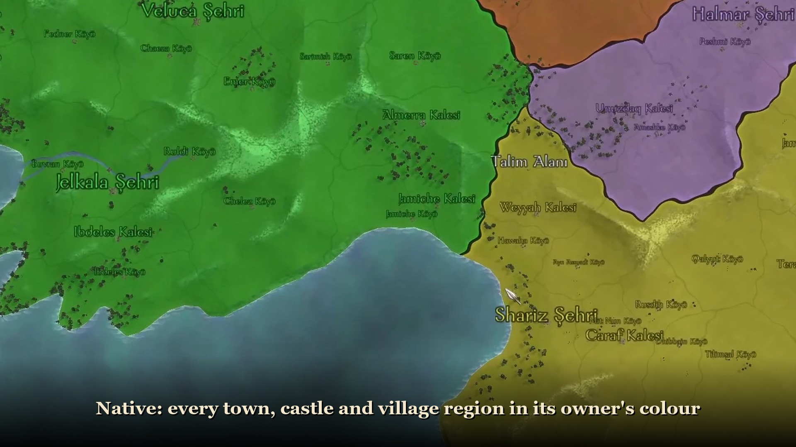

# Colored Political Regions & Borders (CPR&B)

**[Download CPRB-Map-Patcher.exe](https://github.com/champierr/Colored-Political-Regions-Borders/releases/latest/download/CPRB-Map-Patcher.exe)**
 · [All downloads](https://github.com/champierr/Colored-Political-Regions-Borders/releases/latest)
 · [Install video](https://github.com/champierr/Colored-Political-Regions-Borders/releases/latest/download/cprb_install_tutorial.mp4)
 · [Nexus Mods page](https://www.nexusmods.com/mbwarband/mods/6853)
 · [Bannerlord version](https://github.com/champierr/Colored-Political-Regions-Borders-Bannerlord)

> **Tested and stable on Native and Crusade Against Jihad.** Other mods have not been tested in game yet;
> please [open an issue](https://github.com/champierr/Colored-Political-Regions-Borders/issues) with how it
> works in yours.

A political map for **Mount & Blade: Warband**. Every town, castle and village region on the world map takes
its owner's colour, and countries are separated by a fixed dark border line with a soft glow of each side's
colour. Zoomed out you see the political map; zoom in and the colour fades away to the normal terrain while
the borders stay.

- Colours are the game's own faction colours (the same as the map labels), so they follow any mod and any
  change made during play, such as a new player kingdom.
- Ownership updates live, every frame.
- Sea and rivers are left untouched.
- **Ctrl+1** on the world map opens a small settings panel (top left) with a map colour opacity bar
  (0-100 %). Let go of the bar and the map shows it; **Done** saves it with your game, Esc or **Cancel**
  goes back. The patcher sets the starting value for new games.
- **Ctrl+2** picks your own kingdom's colour (top right): click or drag in the colour field and the
  lightness bar, let go, and your land, borders and town names show it. **Done** saves it with your game,
  Esc or **Cancel** brings the old colour back. It needs a kingdom of your own (a town, castle or village
  you hold for yourself); otherwise the panel says so.

## Install

### Native
Subscribe to **Colored Political Regions & Borders** on the Steam Workshop, or extract
`Colored_Political_Regions_and_Borders_Native_v1.2.0.zip` from the
[Releases](https://github.com/champierr/Colored-Political-Regions-Borders/releases/latest) into
`Mount&Blade Warband\Modules\`. Pick it in the launcher and start a new game.

### Any other mod: CPR&B Map Patcher
1. Download [CPRB-Map-Patcher.exe](https://github.com/champierr/Colored-Political-Regions-Borders/releases/latest/download/CPRB-Map-Patcher.exe).
2. Run it. The app is not code-signed; if Windows SmartScreen warns, click *More info* > *Run anyway*.
3. Pick your mod from the list (Steam and Workshop mods are found automatically, or use **Browse...**),
   choose the starting opacity and press **Install / Update**.
4. Start a **new game** for the safest result.

**Uninstall** in the patcher removes exactly what it added. The original files are kept in
`<mod>/CPRB_backup` until then.

> When Steam updates a Workshop mod it downloads that mod's files again, which removes the patch. Run the
> patcher again after such updates.

### Requirements and limits
- DirectX 9 renderer (the launcher's default). OpenGL (Mac/Linux) and WSE2 are not supported.
- Up to 320 towns, castles and villages and up to 96 factions per mod.
- Centers are found by their usual ids: `p_town_*`, `p_castle_*`, `p_village_*`.
- Mods with their own compiled shaders (`mb.fx`, `mb_2a.fxo`, `mb_2b.fxo`) keep them: the patcher swaps in
  only the four world map terrain techniques, so effects such as waving flags stay. Mods that ship shader
  *source* (`mb.fx` as text) are not supported yet.

Played and stable: Native and Crusade Against Jihad. Install and uninstall were also checked (files only, not
in game) on Conquest 1453, Diplomacy and two other Calradia based Workshop mods.

## Screenshots
| | |
|---|---|
|  |  |
|  |  |
|  |  |

## How it works
The political map is drawn inside the world map terrain shaders, so it is part of the terrain instead of a
layer on top of it.

1. The patcher appends a script, a per-frame trigger and the settings window to the mod's compiled files
   (`scripts.txt`, `simple_triggers.txt`, `presentations.txt`, `quick_strings.txt`). Every frame the script
   sends the shaders the position and owner of every center, the colour of every faction and the opacity
   with `set_shader_param_float4`. Nothing existing is renumbered. The opacity is kept in a slot of the
   player troop, so it travels with the savegame.
2. The terrain pixel shader (`shaders/cprb_map.fxh`) finds the two nearest centers of every pixel, blends the
   owner's colour into the terrain by zoom level, and draws the border line and glow where two owners meet.
3. For mods with their own compiled shaders, `patcher/fx_effect.py` reads the compiled effect (fx_2_0),
   replaces the bytecode of the world map terrain techniques with the CPR&B ones and adds their parameters.

## Building from source
Needs Python 3.10+ and `fxc.exe` from the
[TaleWorlds Warband shader kit](https://download.taleworlds.com/mb_warband_shaders.zip) in `shaders/`.

| Command | Does |
|---|---|
| `python tools/build_shaders.py` | Compiles the shader variants (192, 256, 320 centers) into `patcher/shaders/` |
| `build_all.bat` | Builds Native from `src/` (Module System 1.171 ported to Python 3) and applies the patcher to it |
| `python patcher/cprb_patcher.py info\|install\|uninstall <mod folder>` | Patcher from the command line |
| `python tools/build_exe.py <python of the build environment>` | Builds `patcher/dist/CPRB-Map-Patcher.exe` (see below) |
| `python tools/package_release.py` | Release files in `release/v<version>/` and the Nexus files in `release/nexus/` |
| `python tools/make_media.py` | Store images, tutorial video and icon from `docs/screens/` |

Look and feel (fade distances, border width and colour, glow) are the `CPRB_*` values at the top of
`shaders/cprb_map.fxh`.

### Building the patcher exe
PyInstaller's prebuilt bootloader is used by so many programs, some of them malware, that several antivirus
engines flag any exe made with it. The release exe is built with a bootloader compiled from source:
1. Get a MinGW-w64 gcc (for example [w64devkit](https://github.com/skeeto/w64devkit)) and the PyInstaller
   source of the installed version (`pip download pyinstaller==<version> --no-binary :all: --no-deps`).
2. In its `bootloader` folder, with gcc on the PATH: `python waf all --gcc --target-arch=64bit`.
3. Install that PyInstaller into its own environment: `python -m venv --system-site-packages <env>`, then
   `<env>\Scripts\python -m pip install --no-deps --ignore-installed <source>`.
4. `python tools/build_exe.py <env>\Scripts\python.exe`

## Credits
Mount & Blade: Warband, its Module System and shader source are by TaleWorlds Entertainment.

---

## Türkçe

**Colored Political Regions & Borders**, Warband dünya haritasını politik harita gibi boyar. Her bölge
sahibinin rengini alır, ülkeler arasında sabit siyah bir sınır ve iki yanında ülkelerin kendi renginde hafif
bir hüzme çizilir. Yakınlaşınca renk kaybolur ve fiziki harita kalır; sınırlar kalır. Renkler oyunun kendi
faction renkleridir (harita yazılarıyla aynı).

**Bannerlord sürümü:** [Colored-Political-Regions-Borders-Bannerlord](https://github.com/champierr/Colored-Political-Regions-Borders-Bannerlord).

**Test durumu:** Native ve Crusade Against Jihad'da test edildi ve stabil. Diğer modlar oyunda henüz test edilmedi.

**Başka bir modda kullanmak için:** Releases sayfasından `CPRB-Map-Patcher.exe` dosyasını indir, çalıştır,
listeden modu seç ve **Install / Update**'e bas. Yeni oyun başlatman önerilir. Steam bir Workshop modunu
güncellerse yamayı tekrar uygula.

**Oyun içi ayar:** Dünya haritasında **Ctrl+1** ile açılan pencereden renk opaklığını %0-100 arası
ayarlayabilirsin; çubuğu bırakınca harita gösterir, **Done** kayıt dosyana kaydeder, Esc ya da **Cancel** geri alır.

**Krallık rengi:** Kendi krallığın varsa (kendine ait bir şehir, kale ya da köy), **Ctrl+2** ile açılan
renk seçiciden krallığının rengini seçebilirsin. Fareyi bırakınca toprakların, sınırların ve şehir isimleri değişir;
**Done** kaydeder, Esc ya da **Cancel** eski rengi geri getirir.
